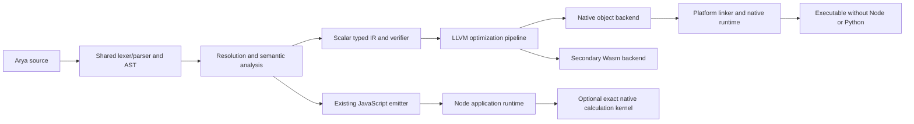

# Target compiler and runtime architecture

This is a design following the [current audit](architecture-audit.md) and
[master requirements](arya-master-plan.md). The [native preview](native-preview.md) implements a bounded scalar typed IR and LLVM executable path. Broader components below remain planned. Existing JS syntax, semantics, module contracts and
application integrations remain the compatibility baseline.

## Boundaries

The existing AST is source-oriented and retains lexical identities/positions.
A typed IR must instead make values, conversions, effects, blocks, calls, errors
and ABI boundaries explicit. It must have a deterministic text form, a verifier,
source spans and versioned serialization/cache identity. The first real lowering
must execute tested programs; an unused IR data structure is not a completed backend.

Preserve current `number` behavior. New `i64`, `u64`, bigint, decimal or Money types
need separate specified conversions, overflow behavior and approved syntax/migration.
No native optimization may silently turn a JS-compatible numeric value into an
integer or introduce financial binary-float arithmetic. Keep exact financial and
approximate scientific operations distinct.

## Backend evaluation and provisional direction

| Approach | Evidence and fit | Costs / required evaluation |
| --- | --- | --- |
| LLVM | Official frontend/object/debug tutorials and target-independent code generator; broad AOT toolchain and optimization path | Larger compiler dependency and integration surface; measure compile time, object size, runtime quality, debug information and SDK/linker distribution |
| Cranelift | General IR-to-machine-code library, AOT/JIT use, x86-64/ARM64 support and verification focus | Rust integration/toolchain and different optimization tradeoffs; qualify required OS/object/debug/Wasm workflows rather than inferring support from ISA support |
| C emission via qualified Clang/GCC | Existing historical Arya evidence and minimal dependency for experiments; useful independent differential backend | C evaluation order/overflow/GC roots must preserve semantics; debug mapping, optimizer UB and Windows ABI details need explicit treatment |

Primary references: [LLVM frontend/object/debug tutorial](https://llvm.org/docs/tutorial/MyFirstLanguageFrontend/index.html),
[LLVM code generator](https://llvm.org/docs/CodeGenerator.html),
[Cranelift design and scope](https://cranelift.dev/),
[Wasmtime platform qualification](https://docs.wasmtime.dev/stability-tiers.html).

Provisional production direction: evaluate LLVM first for optimizing native objects
and debug information; retain Cranelift as a measured alternative. C emission may
be an interim differential/proof backend, not an automatic production selection.
An LLVM scalar preview now executes real programs; no comparative LLVM/Cranelift Arya benchmark has yet been run. Freeze
an architecture decision only after the common typed IR fixture compiles and runs
through candidates with equivalent numeric semantics.

## Minimal native acceptance

1. Lower a deliberately bounded core (literals, checked numeric expressions,
   lexical bindings, direct functions, branches and return) from the shared frontend.
2. Verify typed IR and reject unsupported operations with original source locations.
   No silent fallback to Node or a helper subprocess is allowed for native output.
3. Emit an object, link a hello/calculator executable and execute it with PATH and
   environment excluding Node/Python. Inspect dynamic dependencies and retain hashes.
4. Add debug/release modes and test arithmetic/overflow/evaluation order against the
   JS/reference contract; distinguish native build time from execution time.
5. Qualify x86-64/ARM64 on macOS/Linux/Windows separately. Cross-compiling an object
   is not proof that a linked executable runs on that target.
6. Expand language coverage only after explicit runtime/GC/error/ABI ownership rules.
   Keep native preview opt-in and JS as the existing application path.

## Memory, effects and FFI

Preserve GC-managed user ergonomics initially; do not impose ownership/borrowing
syntax on existing code. A native GC/rooting approach needs a written lifetime
model and stress/sanitizer tests before records, closures or cycles are supported.
Account for error exits and temporary roots, not just happy-path allocations.
Resources such as transactions, files and worker clients require deterministic
close/cleanup independent of garbage collection.

A future public C ABI should use versioned POD descriptors/status codes, explicit
lengths, explicit caller/callee allocation ownership, matching free functions and
thread/handle lifetimes. Do not export C++ classes or private `__int128` layouts as
portable ABI promises. Canonical decimal strings or documented scaled integer
layouts are initial exact-value interchange candidates. Add Python/Node bindings
on that ABI after native ownership/error semantics are verified; NumPy/zero-copy
views require separate pinned-lifetime and concurrency contracts.

The current Node-API batch addon is a small experiment at an existing JS boundary.
Its internal column ABI is not the future public language FFI. Native compilation
must not load JavaScript/Python unless a program explicitly uses a bridge requiring
that host. Unsupported optional host features must be diagnosed at the boundary.

## Financial and ecosystem design

Exact decimal contexts, currency-aware immutable Money values, explicit FX records
(rate/source/timestamp), ISO currency data and accounting invariants belong to
versioned libraries over typed values. The bounded batch engine is one such
calculation component; it does not replace arbitrary precision or a ledger system.
Add journal validation, costing and statements as independently testable packages.

Keep standard modules modular and optional integrations isolated. Preserve the
current passive editor/compiler boundary, source positions and cache invalidation.
A new native backend must consume shared frontend results rather than duplicating
lexing or semantic resolution in each editor or runtime.

Use existing npm packaging while defining the independent manifest/resolver threat
model. New CLI commands and package features require executable acceptance cases;
registry publication, signing identities and stable support policy are separate
owner-authorized operations. No external Arya Ledger changes are part of this plan.
